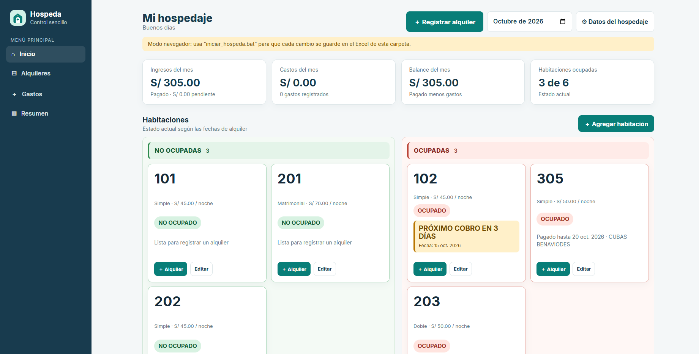
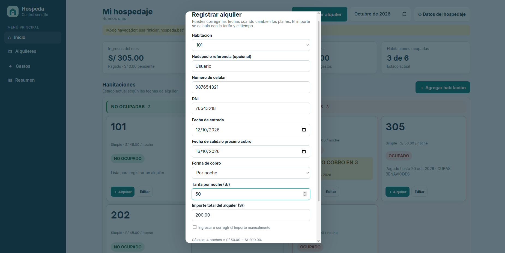
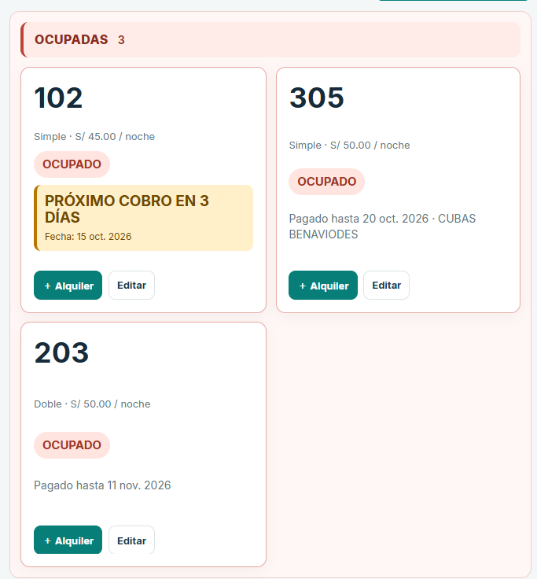
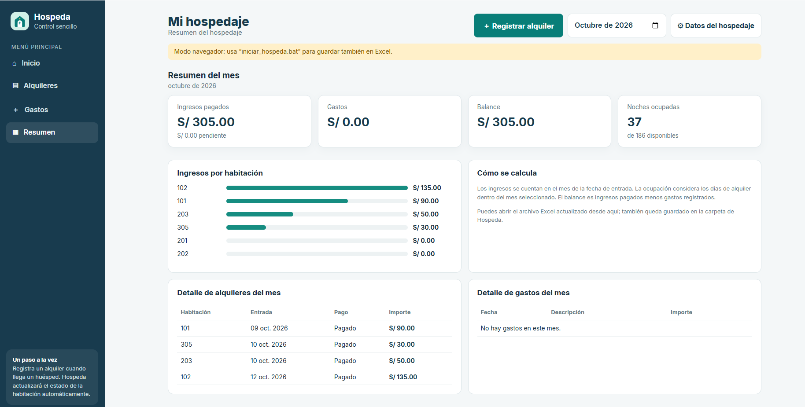

# Hospeda

Aplicación de escritorio local para gestionar habitaciones y alquileres de un hospedaje. Reemplaza el registro manual en papel por una herramienta visual que organiza ocupación, huéspedes, pagos e ingresos.

**Estado:** Completado · **Plataforma:** Windows · **Uso:** local, en una sola computadora

## Capturas de pantalla

Las siguientes imágenes muestran las principales pantallas de Hospeda. Los registros mostrados son ficticios.

<table>
  <tr>
    <td width="50%"></td>
    <td width="50%"></td>
  </tr>
  <tr>
    <td align="center"><strong>Panel principal</strong> Habitaciones, ocupación e indicadores del mes.</td>
    <td align="center"><strong>Registro de alquiler</strong> Datos del huésped, fechas, tarifa y monto.</td>
  </tr>
  <tr>
    <td width="50%"></td>
    <td width="50%"></td>
  </tr>
  <tr>
    <td align="center"><strong>Habitaciones ocupadas</strong> Estado de cada habitación y próximos cobros.</td>
    <td align="center"><strong>Resumen mensual</strong> Ingresos por habitación, alquileres y gastos.</td>
  </tr>
</table>

## Problema que resuelve

En un hospedaje pequeño, llevar habitaciones, fechas de alquiler, pagos y gastos en papel puede dificultar saber qué cuartos están ocupados y cuánto se generó durante el mes. Hospeda reúne esos registros en un panel sencillo y permite consultar la información del negocio.

## Funciones principales

- Crear y editar habitaciones, identificadas con el número y tipo que el hospedaje necesite.
- Ver las habitaciones disponibles y ocupadas de forma separada.
- Registrar alquileres con nombre del huésped, DNI, celular, fechas, modalidad de cobro y monto.
- Consultar el estado de pago y los días restantes del alquiler.
- Registrar gastos y consultar los ingresos y gastos del mes.
- Guardar los datos de la aplicación localmente en una base SQLite.
- Actualizar un archivo Excel con los datos de respaldo del alquiler y crear copias JSON locales.

## Tecnologías

| Tecnología | Uso |
| --- | --- |
| HTML, CSS y JavaScript | Interfaz y comportamiento de la aplicación |
| Python | Servidor local y operaciones con los datos |
| SQLite | Almacenamiento local de habitaciones y alquileres |
| Excel (`.xlsx`) y JSON | Archivos de respaldo |

## Cómo iniciar en Windows

1. Descarga o descomprime la carpeta del proyecto en la computadora.
2. Instala Python 3.9 o posterior si aún no está instalado.
3. Abre `iniciar_hospeda.bat`. Se iniciará el servidor local y se abrirá la aplicación en el navegador.
4. Opcional: abre `crear_acceso_directo.bat` para crear un acceso directo en el escritorio.

Hospeda funciona en la computadora donde se inicia y no necesita una cuenta en línea para guardar los registros.

## Almacenamiento y privacidad

La información de operación se guarda localmente. El Excel y las copias de respaldo pueden contener nombres, DNI y teléfonos; por eso, los archivos de datos reales no se incluyen en este repositorio. Las capturas de esta página usan datos ficticios.

## Archivos principales

- `index.html`: interfaz de la aplicación.
- `server.py`: servidor local, almacenamiento SQLite y generación de respaldos.
- `iniciar_hospeda.bat`: inicia Hospeda en Windows.
- `crear_acceso_directo.bat`: crea el acceso directo en el escritorio.
- `hospeda-logo.svg` y `hospeda.ico`: recursos de identidad visual.

## Alcance actual

Proyecto completado para su uso local en computadora con Windows. Los datos permanecen en ese equipo; esta versión no sincroniza información con la nube ni con otros dispositivos.
